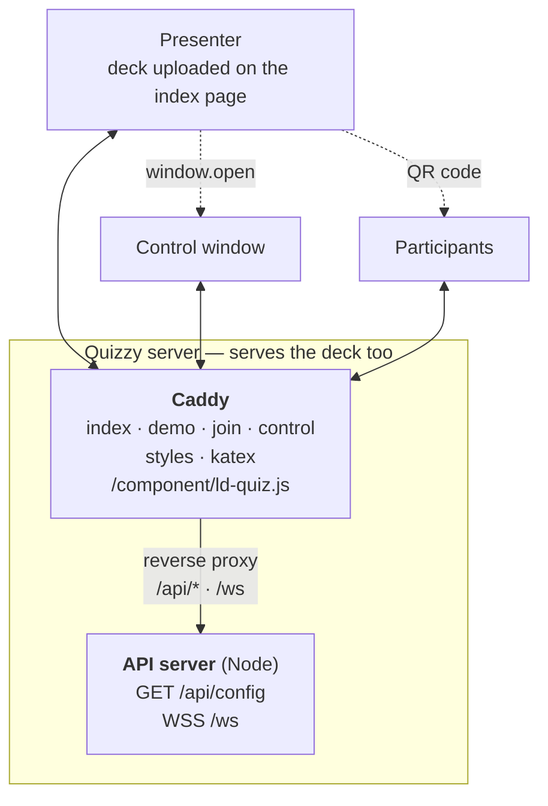
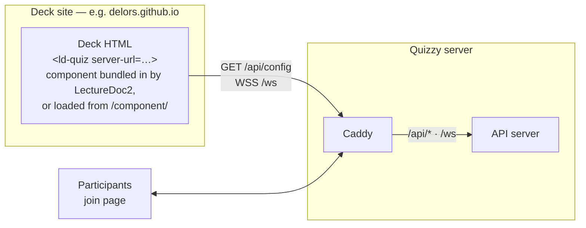
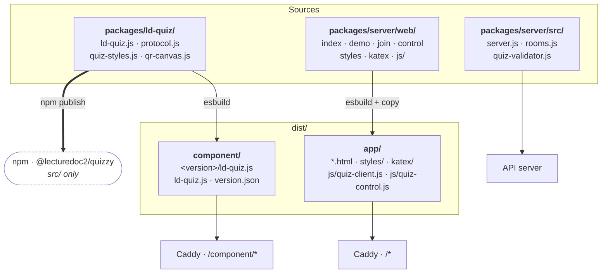
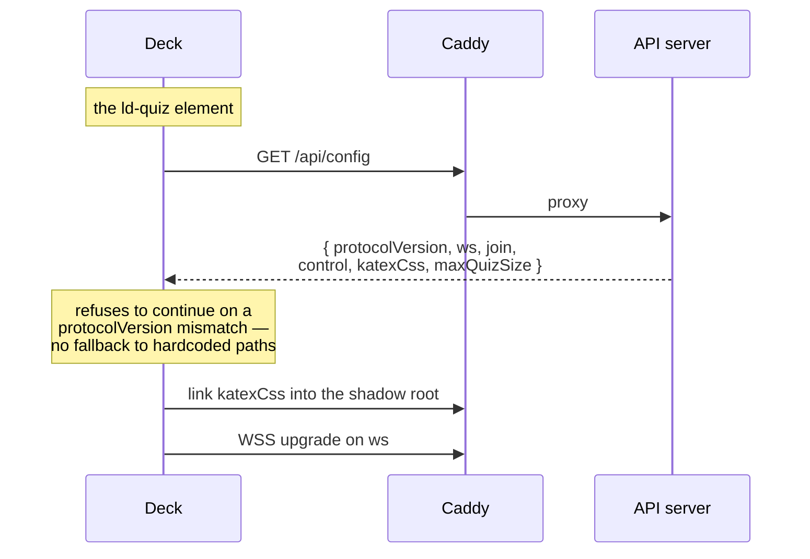
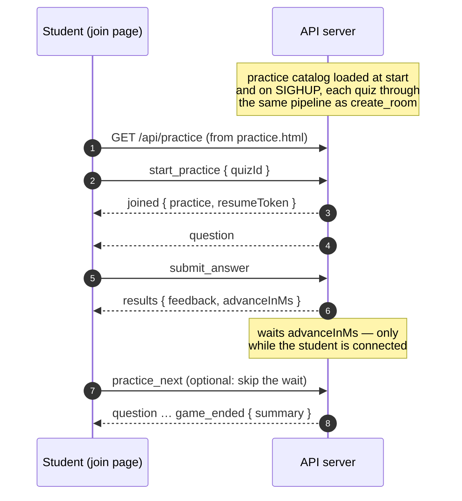

# Architecture

## Terminology

Used precisely everywhere in this repository. "Host" and "server" on their own
are avoided, because they can easily be confused.

| Term | What it means |
|---|---|
| **Quizzy server** | The deployment described by `DEPLOY.md`: **Caddy** in front, the **API server** (Node, Express + `ws`) behind it. Together they serve the application pages and answer `/api/config` and `/ws`. |
| **deck** | The presentation carrying `<ld-quiz>` — an uploaded HTML file, or a LectureDoc2 slide set published elsewhere. |
| **`server-url`** | The attribute on `<ld-quiz>` naming the Quizzy server the deck talks to. Defaults to the origin the deck itself was served from. |
| **participant** / **presenter** | The two human roles. The presenter has the deck plus a control window; participants have their phones. |
| **practice** | A game one participant plays alone, with no presenter, from a quiz in the server's **practice catalog**. The API server moves it on by itself. |

Note that, the component may be bundled
into the deck by LectureDoc2, installed from npm, or fetched from `/component/`
on the Quizzy server; it uses neither `import.meta.url` nor `document.currentScript`
and never consults its own origin. Everything it needs — the WebSocket, the join
and control pages, the KaTeX stylesheet — is resolved against `server-url`. So
the component's file origin has no runtime consequence, and only `server-url`
decides which Quizzy server a deck belongs to.

Note the Quizzy server is *two programs*, not one. Caddy serves every static
file; the API server serves no static files at all — one HTTP route
(`GET /api/config`) and the WebSocket upgrade. That division is why `dist/` is
shaped the way it is.

---

## The simple case: one server, nothing else

This is the whole system for most users, and it is what `DEPLOY.md` produces.



Deploy once, open the index page, upload a deck, present. The deck, the
component, the pages and the API are all one origin, so there is no CORS, no
`server-url` attribute to set, and nothing to configure.

## The second case: the deck lives somewhere else

A LectureDoc2 slide set is published to its own site. The deck bundles the
component from npm, or loads it from the Quizzy server — either way the
Quizzy server is now a *different origin* from the deck.



Only two things change: the deck sets `server-url`, and the Quizzy server must
allow that origin. For static files it already does: Caddy sends
`Access-Control-Allow-Origin: *` with every one, so the component and its
stylesheets load from anywhere. The API's CORS is the API server's, governed by
`ALLOWED_ORIGINS` (DEPLOY.md §13). Everything else — the join page, the control
window, the protocol — is identical.

---

## Which files belong to which part

The browser code has to be bundled before anything can serve it: it imports the
crypto library by its bare specifier (`@lecturedoc2/libcrypto`), which browsers
cannot resolve on their own. `build.js` uses esbuild to bundle each browser entry
point, inlining the library, and assembles `dist/` so that its layout matches the
public URLs one-to-one.

`dist/` has two halves, because two different people deploy them.



**`dist/component/` is the only half an embedder ever needs.** One file, plus
its source map. If a deck on another site is to load the component, this is the
directory that has to be reachable — nothing else.

**`dist/app/` is the Quizzy server's own website** and is of no interest to
anyone embedding the component.

| URL | Source | Served from | Cache |
|---|---|---|---|
| `/component/<version>/ld-quiz.js` | `packages/ld-quiz/src/ld-quiz.js`, bundled | `dist/component/` | immutable, one year — pin this |
| `/component/ld-quiz.js` | the same bundle | `dist/component/` | `no-cache`; tracks the deployment |
| `/`, `/join.html`, `/practice.html`, `/control.html`, `/demo.html`, `/tools.html` | `packages/server/web/*.html`, copied | `dist/app/` | default |
| `/js/*` | `packages/server/web/js/`, bundled | `dist/app/` | default |
| `/styles/*`, `/katex/*`, `/highlight/*` | `packages/server/web/`, copied | `dist/app/` | default |
| `/api/config`, `/api/practice`, `/ws` | `packages/server/src/` | API server, via Caddy | — |

Consumers that run a bundler themselves can skip all this and import the
component's sources from npm instead.

KaTeX is served by the **Quizzy server** — Caddy, out of `dist/app/katex/` — at
whatever path `/api/config` reports, and `<link>`ed into the component's shadow
root rather than inlined. Its `@font-face` URLs are relative, so a copy embedded
in the bundle would resolve the fonts against the *deck's* origin and silently
replace every formula with a fallback font, precisely in the cross-origin setup
of the second case. This is a good illustration of the rule above: the
stylesheet comes from `server-url`, not from wherever the component file was
loaded from.

---

## Language

The participant pages (`join.html`, `practice.html`) speak German or English, as
the student's browser prefers (`navigator.languages`), and English when it
prefers neither; `?lang=de` or `?lang=en` overrides that and is carried along on
the pages' own links. Nothing is stored on the device to remember the choice.

The texts live in one resource file per language, `packages/server/web/locales/`,
which esbuild inlines into the page bundles; `web/js/i18n.js` picks the language
and fills them in. The lecturer's pages, the `<ld-quiz>` component and the
authoring tools are still English only.

The API server does not know the student's language and does not need to. Every
error a participant can receive carries a machine-readable `code` (and `params`
where the text has numbers in it, e.g. `{ "code": "name_too_short", "params":
{ "min": 2 } }`); the join page shows the translation of `error.<code>`. The
English `message` stays in every error, for the clients that do not translate
yet. Both fields are additive, so the protocol version did not change.

---

## Authoring runs in the browser, not on the server

`/tools.html` validates a quiz, encrypts one, and generates a `secret`. All
three run in the author's tab. The API server gained no route for any of them,
and that is the design rather than an omission.

Validation needs only the file. Encryption needs the file **and the password** —
and that password is the one thing in this system that must not travel: it gates
the encrypted quiz that every participant already holds a copy of, and via the
quiz's `secret` it gates the presenter token as well (see
[PRESENTER-TOKEN.md](PRESENTER-TOKEN.md)). A `POST /api/encrypt` would have been
a new route accepting an arbitrary body, holding lecturers' passwords in memory,
and passing them through Caddy's request buffers and anything that logs. There
is nothing it could compute that `crypto.subtle` in the author's own browser
cannot, so the attack surface would have bought nothing.

What that costs is one constraint and one duplication risk:

- **Secure context.** `crypto.subtle` is undefined outside HTTPS and
  `localhost`, so encryption is unavailable on a plain-HTTP deployment. The page
  detects this and says so; validation is pure JavaScript and keeps working.
- **Two front ends, one implementation.** The page and the `tools/` CLI scripts
  both import `packages/server/src/quiz-validator.js` (the very function the
  server runs before it will create a room), `quiz-secret-advice.js` and
  `quiz-encryption.js`. The PBKDF2 iteration count in particular lives in one
  place on purpose: a browser path that quietly used a smaller number would
  produce files indistinguishable from the CLI's and cheaper to break.

The page also carries `connect-src 'none'` in its CSP, which makes "nothing is
uploaded" enforced by the browser rather than merely intended.

---

## Service discovery

The component is told one thing, `server-url`, and asks for the rest.



One fetch per origin, shared by every `<ld-quiz>` on the page — a deck can carry
a dozen. The response and the version gate are specified in the README, under
"Service discovery" and "Protocol versioning". `PROTOCOL_VERSION` lives in
`packages/ld-quiz/src/protocol.js`, which the API server imports through a
relative path, so the two halves cannot disagree about it within one checkout.

---

## Playing a round

```mermaid
sequenceDiagram
    autonumber
    participant D as Deck
    participant K as Control window
    participant A as API server
    participant P as Participant

    D->>A: create_room (protocolVersion, quiz)
    Note over A: the quiz is validated for shape<br/>before a room exists at all —<br/>see quiz-validator.js
    A-->>D: room_created { roomId }
    Note over D: renders the join URL and its QR code
    D->>K: window.open(control.html)
    K->>A: control_connect
    A-->>K: control_connected

    P->>A: join_room { roomId, name, consent? }
    A-->>P: joined
    A-->>D: participant_joined
    A-->>K: participants_list

    K->>A: start_game
    A-->>P: question
    A-->>K: question_started

    P->>A: submit_answer
    Note over A: rejected, not coerced,<br/>if it is not the shape<br/>this question accepts
    A-->>P: answer_accepted
    A-->>K: answer_count

    opt changed while others are still answering
    P->>A: submit_answer
    Note over A: replaces the earlier answer;<br/>the count stays as it is
    A-->>P: answer_accepted { replaced }
    end

    Note over A: ends on the time limit, or once<br/>every present participant has answered
    A-->>D: question_results
    A-->>K: question_results
    A-->>P: question_results

    opt a right short answer the matching missed
        K->>A: accept_answer { questionIndex, answer }
        Note over A: re-scores every answer<br/>in the same normalized form
        A-->>P: results
        A-->>K: question_results
    end

    K->>A: next_question
    K->>A: end_game
    A-->>D: results
    A-->>K: results_export
```

Participants can resume, like the presenter. A dropped participant socket
*detaches* the participant rather than deleting them: they keep their score and
their place on the leaderboard, and stay out of everything that is about who is
present, such as the count that auto-ends a question. The join page reconnects with
backoff and jitter and presents the resume token it received in `joined`
(`rejoin_room`). The token lives in memory and, for a reload, in the tab's
`sessionStorage`. Detached participants are forgotten after
`DETACHED_RETENTION_MINUTES`. See `PARTICIPANT-REATTACH.md`.

## Practice: a round with nobody presenting

A practice game is an ordinary room with its presenter taken out. Everything
that makes a room close a question by itself already existed — the time limit,
and "every connected participant has answered", which with one participant
means *as soon as they answer*. What practice adds is the one step a presenter
used to take: after `practiceResultsMs` (the catalog's `resultsSeconds`) on a
results screen, the API server sends the next question, or ends the game.



The design points that are not obvious from the diagram:

- **One quiz, many games.** Each catalog quiz is validated and rendered once and
  frozen; every game of it shares that object. A practice room is therefore
  small, which is what lets a hall practise at once.
- **Invisible to everyone else.** `join_room`, `room_status` and
  `control_connect` answer a practice room's id exactly as they answer an
  unknown one. Its presenter token is random and never handed out.
- **Its own quotas.** Practice games are counted apart from lecture rooms
  (`MAX_PRACTICE_ROOMS`, `maxPracticeGamesPerIp`), so practising can never stop
  a lecture from opening a room.
- **It waits for an absent student.** The countdown is only armed while the
  student is connected; a dropped connection leaves the game on its next results
  screen, and `rejoin_room` starts the countdown again. A finished game is
  removed as soon as its socket closes, an abandoned one after
  `DETACHED_RETENTION_MINUTES`.
- **Verdicts, not answers**, and estimates scored by relative error rather than
  by rank: what a student sees is described under "Practice Mode" and "Supported
  Question Types" in the README.

---

Room state lives only in the API server's memory. Nothing is persisted, so a
restart ends every running game — which is also why the room TTLs in `rooms.js`
matter, and why a malformed quiz must never be able to end the process: it would
take every other lecture on the Quizzy server with it.

---

Deploying a Quizzy server: `DEPLOY.md`. Updating one: `UPDATE.md`. Running one
locally: `DEVELOPMENT.md`. Releasing the npm package: `PUBLISH.md`. What is
protected against whom, and how: `SECURITY_ARCHITECTURE.md`.
