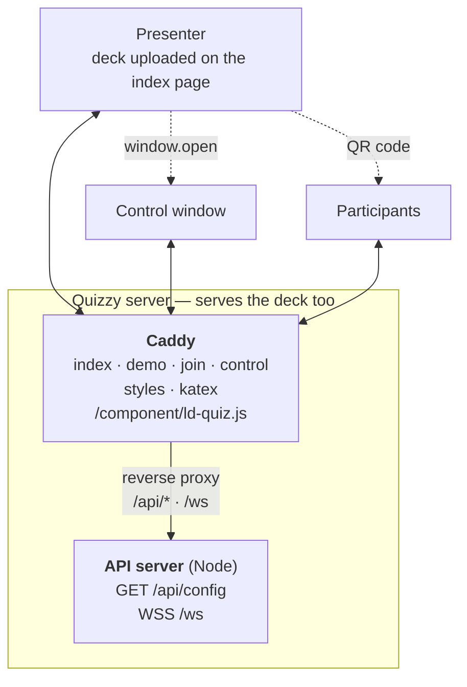
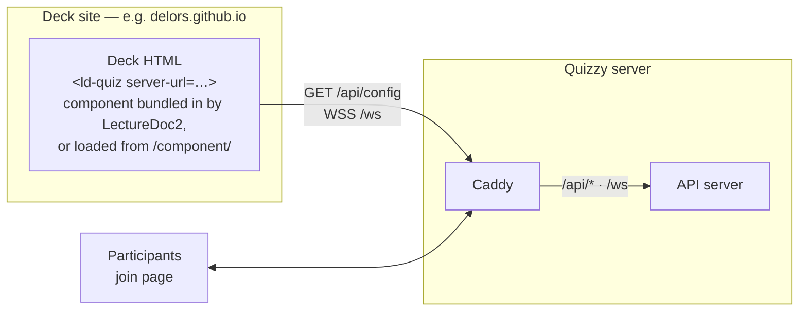
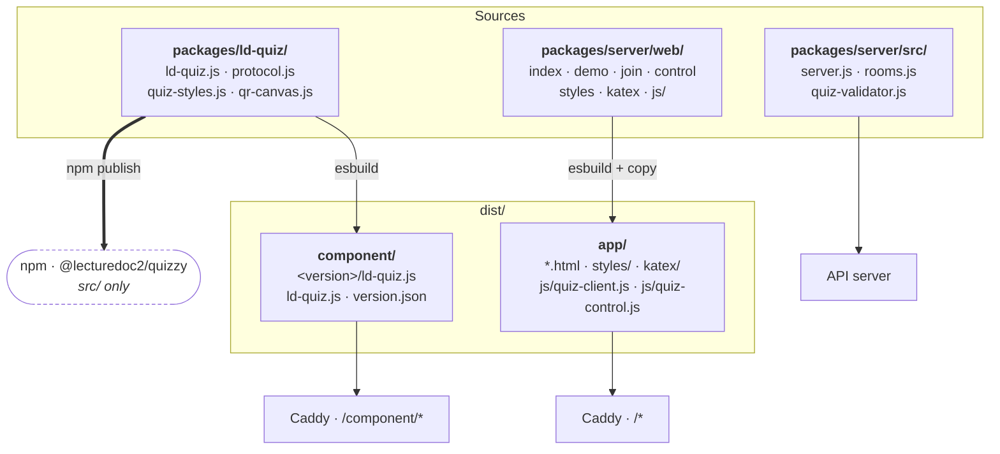
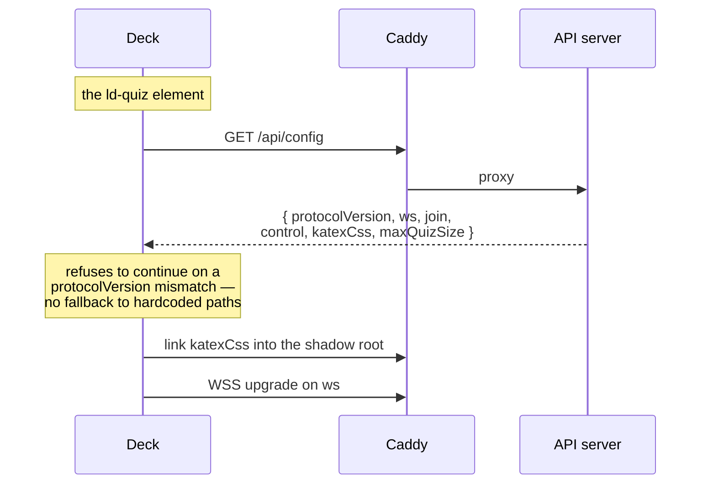
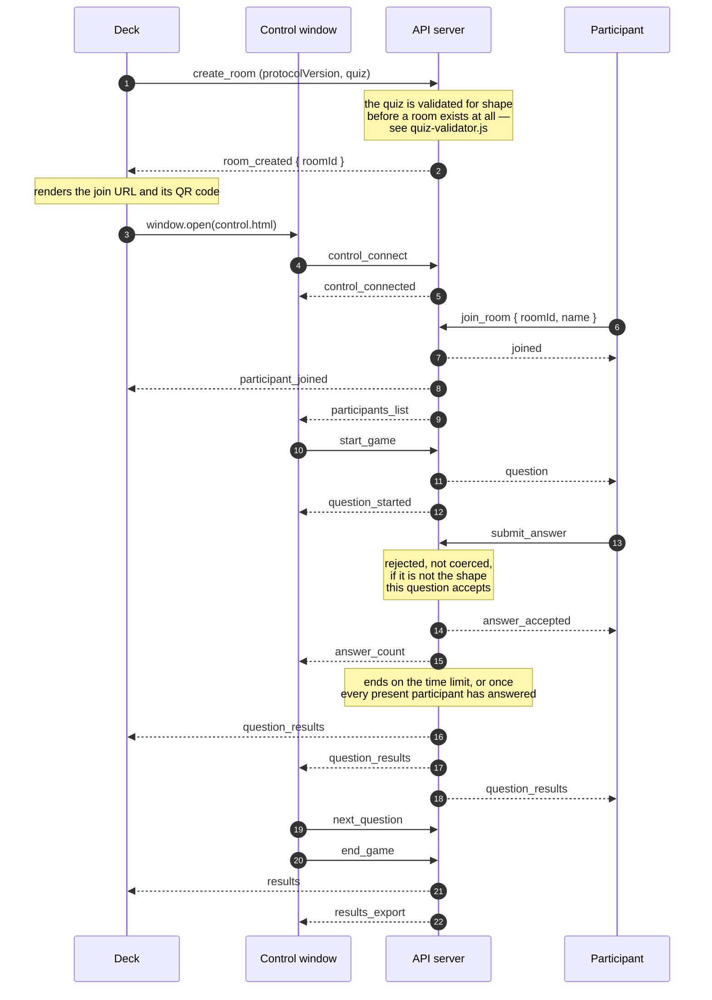

# Architecture

## Terminology

Used precisely everywhere in this repository. "Host" and "server" on their own
are avoided, because they can easily be confused.

| Term | What it means |
|---|---|
| **Quizzy server** | The deployment described by `DEPLOY.md`: **Caddy** in front, the **API server** (Node, Express + `ws`) behind it. Together they serve the application pages and answer `/api/config` and `/ws`. |
| **deck** | The presentation carrying `<ld-quiz>` — an uploaded HTML file, or a LectureDoc2 slide set published elsewhere. |
| **`server-url`** | The attribute on `<ld-quiz>` naming the Quizzy server the deck talks to. Defaults to the origin the deck itself was served from. |
| **participant** / **presenter** | The two human roles. The presenter has the deck plus a control window; participants have their phones. |

Note that, the component may be bundled
into the deck by LectureDoc2, installed from npm, or fetched from `/component/`
on the Quizzy server; it uses neither `import.meta.url` nor `document.currentScript`
and never consults its own origin. Everything it needs — the WebSocket, the join
and control pages, the KaTeX stylesheet — is resolved against `server-url`. So
the component's file origin has no runtime consequence, and only `server-url`
decides which Quizzy server a deck belongs to.

Note the Quizzy server is *two programs*, not one. Caddy serves every static
file; the API server serves no static files at all — one HTTP route
(`GET /api/config`) and the WebSocket upgrade. That division is why `dist/` is
shaped the way it is.

---

## The simple case: one server, nothing else

This is the whole system for most users, and it is what `DEPLOY.md` produces.

Deploy once, open the index page, upload a deck, present. The deck, the
component, the pages and the API are all one origin, so there is no CORS, no
`server-url` attribute to set, and nothing to configure.

## The second case: the deck lives somewhere else

A LectureDoc2 slide set is published to its own site. The deck bundles the
component from npm, or loads it from the Quizzy server — either way the
Quizzy server is now a *different origin* from the deck.

Only two things change: the deck sets `server-url`, and the Quizzy server must
allow that origin. Everything else — the join page, the control window, the
protocol — is identical.

---

## Which files belong to which part

`dist/` has two halves, because two different people deploy them.

**`dist/component/` is the only half an embedder ever needs.** One file, plus
its source map. If a deck on another site is to load the component, this is the
directory that has to be reachable — nothing else.

**`dist/app/` is the Quizzy server's own website** and is of no interest to
anyone embedding the component.

| URL | Served from | Cache |
|---|---|---|
| `/component/<version>/ld-quiz.js` | `dist/component/` | immutable, one year — pin this |
| `/component/ld-quiz.js` | `dist/component/` | `no-cache`; tracks the deployment |
| `/`, `/join.html`, `/control.html`, `/demo.html` | `dist/app/` | default |
| `/styles/*`, `/katex/*`, `/js/*` | `dist/app/` | default |
| `/api/config`, `/ws` | API server, via Caddy | — |

KaTeX is served by the **Quizzy server** — Caddy, out of `dist/app/katex/` — at
whatever path `/api/config` reports, and `<link>`ed into the component's shadow
root rather than inlined. Its `@font-face` URLs are relative, so a copy embedded
in the bundle would resolve the fonts against the *deck's* origin and silently
replace every formula with a fallback font, precisely in the cross-origin setup
of the second case. This is a good illustration of the rule above: the
stylesheet comes from `server-url`, not from wherever the component file was
loaded from.

---

## Service discovery

The component is told one thing, `server-url`, and asks for the rest.

One fetch per origin, shared by every `<ld-quiz>` on the page — a deck can carry
a dozen. Paths are returned relative to the URL that answered them, so the
Quizzy server can live under a path prefix instead of owning a domain root.

`PROTOCOL_VERSION` (in `packages/ld-quiz/src/protocol.js`, imported by the API
server through a relative path) is the version gate. It is separate from the
package version because the two halves ship on different schedules: a deck pins
a bundled copy of the component, while the Quizzy server is updated by its
administrator.

---

## Playing a round

Room state lives only in the API server's memory. Nothing is persisted, so a
restart ends every running game — which is also why the room TTLs in `rooms.js`
matter, and why a malformed quiz must never be able to end the process: it would
take every other lecture on the Quizzy server with it.

---

Deploying a Quizzy server: `DEPLOY.md`. Releasing the npm package: `PUBLISH.md`.
