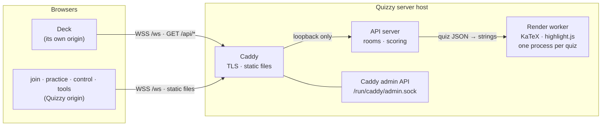

# Security Architecture

What Quizzy protects, against whom, and how. This document is the overview: it
says which mechanism answers which threat and why it is shaped the way it is,
and links to the documents that hold the details. Terms such as *Quizzy server*,
*API server*, *deck* and *`server-url`* are used as defined in
[ARCHITECTURE.md](ARCHITECTURE.md#terminology).

---

## 1. Assets and roles

| Asset | Why it matters | Mainly protected by |
|---|---|---|
| **Availability of running lectures** | Every room lives in the memory of one API server process. Whatever stops or freezes that process ends every lecture on the host at once | §5, §6, §8 |
| **Control of a room** | The presenter token starts, advances and ends questions, kicks participants and decides what is scored | §3 |
| **Quiz content before it is shown** | An encrypted quiz ships inside the deck, so every participant holds the ciphertext; its plaintext also determines the presenter token | §4 |
| **Participant data** | Names, answers and scores, in a setting where results may count towards a grade | §3, §11 |
| **The site itself** | `dist/app` and the component are loaded by every presenter and participant. Whoever can change them runs code in all of those browsers | §9, §10 |
| **Host credentials** | Caddy's TLS private keys; on the DNS-01 profile, a TSIG key with update rights over the DNS zone | §9 |

| Role | Who | Holds |
|---|---|---|
| **Presenter** | The lecturer running a quiz | The quiz file (and with it the presenter token), the control window |
| **Participant** | A student in the room | The room id, and a resume token for their own seat |
| **Practice student** | Someone playing a catalog quiz alone | A practice game nobody else can see |
| **Anonymous client** | Anyone who can reach the Quizzy server — which includes every student | Nothing. But `create_room` needs no account, so this role can open rooms (§2) |
| **Operator** | Whoever administers the host | root; out of scope as an adversary |

---

## 2. Trust boundaries and threat model

| Boundary | What crosses it | Treated as |
|---|---|---|
| Browser → Caddy | HTTP, WebSocket upgrades | Untrusted. TLS ends here |
| Caddy → API server | Proxied `/api/*` and `/ws`, plus `X-Forwarded-For` | The header is believed only from loopback (§8) |
| Client → API server (messages) | Every WebSocket message, **including whole quizzes** | Untrusted, always. See below |
| API server → render worker | One quiz; back come rendered strings | The worker's reply is untrusted (§6) |
| Quizzy server → browsers | Rendered quiz HTML | Author markup, scrubbed but not escaped (§5, §7) |
| Anything on the host → Caddy admin | A complete new Caddy configuration | Only `caddy` and root may connect (§9) |

**The quiz has two trust levels, and keeping them apart is the core of this
design.** In the browser, quiz markup is treated as the lecturer's own content:
trusted but fallible, so it is scrubbed for accidents (§5) rather than escaped.
On the server, the same content is **attacker-controlled**: `create_room` requires
no account, so anyone who can open a WebSocket can send up to 1 MB of quiz JSON,
and with it formulas and code into the two third-party parsers. Everything the
server does with a quiz is designed for that reading: it validates the shape
before anything else, renders in a separate process (§6), and bounds everything
(§8).

**In scope:** an anonymous network attacker (denial of service, probing for
rooms, malicious quizzes); a malicious participant (crafted answers and names);
a curious participant (reconstructing the quiz or the presenter token from what
the projector shows); a compromised dependency; and limiting the damage of a
compromised API server.

**Out of scope:** a malicious operator; a compromised Caddy or Node binary; the
host of a deck (it serves its own JavaScript to its own visitors); the
presenter's own machine.

---

## 3. Authentication and authorization

There are no accounts. Three things stand in for them.

**The presenter token** is a bearer credential: whoever presents it controls the
room. The component derives it in the presenter's browser as
`SHA-256(normalize(presenterName) ‖ NUL ‖ JSON.stringify(quiz))`, so *the quiz
file is the secret*, and the name only keeps two lecturers who share a quiz file
from sharing a session. The server never sees the name, only the hash, and
compares by equality; `create_room` refuses tokens shorter than 32 characters.
Because the token is a function of the quiz, a reconnecting deck resumes its
room by simply sending `create_room` again. Details, and the planned move of
the token from the control window's URL into an HttpOnly cookie:
[PRESENTER-TOKEN.md](PRESENTER-TOKEN.md).

**Resume tokens** let a participant whose connection dropped return to their
seat: 32 random bytes, handed out once in `joined`, never broadcast or logged,
kept by the server in maps apart from the participant record (which is what
leaderboards are built from), and by the browser in the tab's `sessionStorage`.
They expire `DETACHED_RETENTION_MINUTES` after the socket closed. A second
socket presenting the same token supersedes the first (close code 4000), so two
tabs cannot share a seat. Details: [PARTICIPANT-REATTACH.md](PARTICIPANT-REATTACH.md).

**Room ids** are capabilities to *join*, not to control: six characters from a
32-symbol alphabet, about 10⁹ values of which a handful are live. Every probe
gets the same opaque rejection, wrong guesses spend a per-address failure budget
(§8), and there is no endpoint that lists rooms.

**Practice games** have a random presenter token that is never handed out, and
are invisible to everyone but their student: `join_room`, `room_status` and
`control_connect` answer a practice room's id exactly as they answer an unknown
one.

---

## 4. Quiz confidentiality

A deck may carry its quiz **encrypted** (AES-GCM, key from PBKDF2-HMAC-SHA256 at
600 000 iterations; the count is stored per file, so raising it never breaks old
files). The presenter types the password; the component decrypts in the browser.
Every participant holds the ciphertext and can attack the password offline, so
password strength is the whole defense. The iteration count lives in one module
(`quiz-encryption.js`) imported by both front ends, so that the browser path
cannot quietly produce cheaper files than the CLI.

The quiz's **`secret`** field does two jobs. Without it, a participant could
rebuild the quiz JSON from what the projector showed, compute the presenter
token, and hold it for every future session of that quiz. And for an encrypted
quiz, it stops an attacker from recognising a correct password guess by
regenerating the plaintext. `quiz-secret-advice.js` checks for one (128 bits is
the target) in both the CLI and the tools page.

**Authoring runs in the author's browser.** `/tools.html` validates, encrypts and
generates secrets locally, and carries `connect-src 'none'`, so "nothing is
uploaded" is enforced by the browser. There is deliberately no server route that
accepts a password (see ARCHITECTURE.md, "Authoring runs in the browser").

The API server necessarily receives the plaintext quiz at `create_room` and keeps
it in memory for the room's lifetime. Practice catalog entries drop their
`secret` on load.

---

## 5. Input handling

**On the server**, every message is bounded before it is understood:

- 1 MB per message (`ws` `maxPayload`, checked again in the handler), a per-socket
  message rate, `JSON.parse` inside `try`, and a protocol-version gate on every
  handshake message.
- **Quiz shape first.** `quiz-validator.js` rejects anything not shaped like a quiz
  — question count, option count and string lengths are bounded — before a room
  or a render exists. These limits are denial-of-service bounds, not opinions on
  teaching. A malformed quiz once crashed the process from inside a timer.
- **Answers are rejected, not coerced**, if they are not the shape the current
  question accepts (`Room.validateAnswer`).
- **Names** must match a letters-only pattern of 2–50 characters and pass a
  blocklist (`name-validator.js`).
- Every handler sits inside a catch-all that logs and answers "Invalid message".

**The rendering pipeline** (`quiz-pipeline.js`, run only in the render worker,
§6) turns markup into HTML in an order that matters. Code blocks are highlighted
and escaped first. The sanitizer then scrubs the markup *around* them. KaTeX
runs last and skips the code regions. The other orders either eat code samples
that contain `<script>` or read `echo $PATH` as a formula.

**In the browser**, two rules apply:

- **Author markup** goes through `quiz-sanitizer.js`. That is a blocklist (scripts,
  styles, frames, forms, event handlers, `javascript:` URLs). A blocklist on HTML
  is **not a security boundary**: it exists to stop a lecturer from breaking
  their own quiz with pasted markup.
- **Participant-originated data** (names, free-text answers) is never treated as
  markup. It is escaped or inserted with `textContent`. 

---

## 6. Render sandbox

KaTeX and highlight.js are the two components that parse untrusted input with
third-party code. A bug in either could have serious consequences:

- **Freeze:** a regular expression that backtracks forever, or a macro expansion
  that never ends (both libraries have had such bugs) freezes every lecture.
- **Corruption:** a polluted `Object.prototype` corrupts every room.
- **Takeover:** a compromised release owns the process the moment it is imported.

So the invariant is: **neither package is ever imported into the API server
process.** A test walks `server.js`'s import graph and fails if it reaches
`katex`, `highlight.js` or the pipeline that uses them.

Each quiz is rendered by a fresh `render-worker.js`, which reads the quiz on
stdin and writes the rendered strings to stdout. It is thrown away afterwards,
so whatever happens to one worker cannot affect the next quiz.
`render-sandbox.js` runs it in one of two modes:

| | Child mode (default) | Socket mode (`RENDER_SOCKET`, DEPLOY.md §11c) |
|---|---|---|
| Started by | The API server, `child_process.spawn` | systemd, one instance per connection |
| File system | Node permission model: read access to the worker's sources and the two packages only; no writes | Only the server package and `node_modules` exist in its mount namespace; plus the same Node flags |
| Processes, workers, addons | Denied by the permission model | Denied by the permission model; no capabilities |
| Network | **Not restricted by Node 24.** Under the hardened backend unit: loopback only | None (`PrivateNetwork`) |
| Prototype pollution | Impossible: `--frozen-intrinsics` | The same |
| `eval`, `new Function` | Disabled | The same |
| Environment | Empty (no `NODE_OPTIONS` to undo the flags) | systemd's minimal one |
| User | The backend's (`quizzy`) | A throwaway `DynamicUser` |
| Limits | Timeout → `SIGKILL`; heap cap; the backend unit's memory and task caps | `RuntimeMaxSec`, `MemoryMax`, `CPUQuota`, `TasksMax`, plus the backend's timeout |

Node's documentation is explicit that its permission model is a seat belt that
does not hold against code that is *already malicious*. Child mode therefore
stops accidents and opportunistic exploits; socket mode is the boundary.

**What the API server accepts from a worker:** strings, and nothing else.

1. It validates the quiz itself first; a malformed quiz never reaches a worker.
2. The reply must have exactly as many questions, and per question exactly as many
   options, as the quiz that was sent, all of them strings. The reply may be at
   most `RENDER_MAX_OUTPUT_BYTES`. Warnings and errors are capped in number and
   length.
3. The playable quiz is built from the server's own validated copy, with only
   `text` and `options` taken from the reply. Correct answers, types and time
   limits cannot come from a worker, so a subverted renderer can produce hostile
   *markup* — which is what §7 is for — but cannot change scoring or hand the
   server malformed state. (Swapping two rendered options is still possible,
   and would move a multiple-choice question's correct text, or change an
   ordering question's correct order, which is the order of its `options`; that
   is hostile markup too.)
4. Every failure (timeout, oversized reply, malformed reply, crash, missing
   socket) **fails closed**: the quiz is refused with a sentence the presenter can
   act on. There is no in-process fallback, and no setting that brings the
   renderers back into the API server.

**Capacity:** at most `RENDER_MAX_CONCURRENCY` workers run at a time (default 2),
with `RENDER_MAX_QUEUE` waiting (default 16); beyond that the answer is "busy".
A room slot is reserved before the render starts, so a client cannot have more
renders in flight than it may open rooms. Repeated `create_room` with the same
token share one render. A typical quiz takes 75–200 ms, including the process
start.

---

## 7. Browser-side defenses

- **`control.html`** holds the presenter token, so it gets the strictest policy.
  Caddy sends the authoritative copy; the page repeats it in a `<meta>` tag for
  non-Caddy setups. `script-src 'self'` neutralises inline event handlers, the
  only route from injected markup to code execution via `innerHTML`.
  `connect-src` and `img-src` are restricted to this origin, against
  exfiltration. Also `frame-ancestors 'none'`, `Referrer-Policy: no-referrer` and
  `nosniff`. `test/browser/csp.test.js` checks the policy in a real browser.
- **`tools.html`**: `connect-src 'none'` (§4).
- **No ambient authority.** Quizzy sets no cookies. Every privilege travels as an
  explicit token inside a message, so there is nothing for cross-site request
  forgery, or for a cross-site WebSocket connection, to borrow. That is why the
  WebSocket upgrade does not check `Origin`. The planned cookie changes this:
  PRESENTER-TOKEN.md §4 makes an `Origin` check part of that change.
- **CORS:** static files are `Access-Control-Allow-Origin: *`, because decks on
  other origins load the component and stylesheets. The API is GET-only and
  restricted by `ALLOWED_ORIGINS`.
- **No third-party code in browsers.** Of KaTeX and highlight.js, only the
  stylesheets (and KaTeX's fonts) are served, vendored and from this origin. The
  formulas and highlighting arrive pre-rendered.
- **Not covered:** `join.html` and `practice.html` render quiz markup but carry
  no CSP yet (§12). On a deck, the component renders inside the deck's origin,
  under whatever policy the deck sets.

---

## 8. Abuse resistance

| Limit | Default | Bounds |
|---|---|---|
| `MAX_MESSAGES_PER_WINDOW` / `MESSAGE_WINDOW_MS` | 60 / 10 s, per socket | A chatty client |
| `MAX_FAILED_ATTEMPTS_PER_WINDOW` | 50 per minute, per address | Room-id guessing |
| `MAX_ROOMS_PER_IP` | 25 | Rooms one address can hold |
| `MAX_SOCKETS_PER_IP` | 500 | Connections one address can hold |
| `MAX_PRACTICE_GAMES_PER_IP` | 300 | Practice games, counted apart from lectures |
| Rooms on the host | 500 lecture, 2000 practice | Memory |
| Message size | 1 MB | Memory per message |
| `RENDER_*` | §6 | CPU and memory spent rendering |

- **"Per address" means per egress address.** IPv6 clients are bucketed by /64
  (`IPV6_PREFIX_BITS`), because a host can otherwise pick a fresh address per
  connection. The defaults are therefore sized for a NATed lecture hall, not a
  household; DEPLOY.md §13b explains how to size them.
- **Forwarded addresses:** `X-Forwarded-For` is believed only from loopback by
  default (`TRUST_PROXY`), which is right when Caddy shares the host and cannot be
  abused from off-box.
- **Failure budgets survive a reconnect.** Otherwise a prober would get a fresh
  budget with every new socket.
- **Rooms expire:** empty after 90 minutes, finished after
  `ENDED_ROOM_RETENTION_MINUTES`, always after 12 hours. A swept room returns its
  slot to its creator's address.
- **The process stays up on an unexpected exception.** One broken room beats
  twenty ended lectures. That is acceptable only because rooms are independent and
  nothing is persisted that could be left half-written.

---

## 9. Deployment hardening

The production layout ([DEPLOY.md](DEPLOY.md)) is two programs on one host: Caddy
terminates TLS and serves every static file; the API server serves `/api/*` and
`/ws` and nothing else. The hardening rests on one assumption: **the API server
may one day be compromised**, through a dependency or a bug of our own. The
setup therefore limits what a compromised API server can do:

- **It cannot change the code or the site.** The checkout is owned by root and
  the service has no writable path at all; it needs none, because it persists
  nothing. A backend that could write to `/srv/quizzy` could make a compromise
  survive restarts. Worse, it could change `dist/app`, which Caddy serves to every
  participant, and so turn one compromised process into code running in every
  browser that visits.
- **It cannot reach anything but Caddy.** `IPAddressAllow=localhost` with
  `IPAddressDeny=any`: no outbound connections, no second stage, no pivot into
  the campus network, no exfiltration over the network. Off-host connections to
  the backend's port are dropped as well, even if the firewall is misconfigured.
- **It cannot reconfigure Caddy.** On its default `localhost:2019`, Caddy's admin
  API accepts a whole new configuration from any local process. Through it, a
  compromised backend could serve its own pages, or expose any file and
  environment variable Caddy can read: the TLS keys, the TSIG secret. In
  production the admin API is a Unix socket in `/run/caddy`, a directory only the
  `caddy` user can enter (DEPLOY.md §10c, §11b). Caddy's configuration, state and
  socket directories are also hidden from the backend unit.
- **It runs with almost nothing:** a system user without a shell; no
  capabilities; `NoNewPrivileges`; a read-only system; no devices; protected
  kernel, cgroups and clock; a system-call allowlist (`@system-service` minus
  `@privileged`); memory and task caps. Two things are left out on purpose:
  `MemoryDenyWriteExecute` breaks V8's JIT, and `ProcSubset=pid` hides the
  `/proc/meminfo` from which Node sizes its heap.
- **Secrets stay with Caddy.** `/etc/caddy/quizzy.env` (host name, TSIG
  credentials) is `root:caddy`, mode 0640, and invisible to the backend.
- **Network exposure:** a provider security group and `ufw` (DEPLOY.md §3) expose
  only 80/443 (and SSH); the backend's port can additionally be bound to loopback.

`systemd-analyze security` scores each unit; DEPLOY.md §12 lists the checks that
confirm the layout on a live host. [UPDATE.md](UPDATE.md) §7 moves an existing
server to it.

---

## 10. Supply chain

The dependency surface is deliberately small. The API server runs on express,
`ws`, KaTeX, highlight.js and `@lecturedoc2/libcrypto`; the build uses esbuild;
the browser tests use Playwright.

- **The lockfile is the tested tree.** Deployment and CI install with
  `--frozen-lockfile`, and pnpm checks the lockfile against the policies below
  before it installs.
- **No install scripts**, except esbuild's (`allowBuilds` in
  `pnpm-workspace.yaml`): a dependency cannot run code merely by being installed.
- **Nothing younger than a week** (`minimumReleaseAge: 10080`). Hijacked releases
  are usually found and pulled within days. An update that would need a newer
  version fails instead of installing it.
- **No provenance downgrades** (`trustPolicy: no-downgrade`): a version published
  with weaker evidence of its origin than its predecessors is refused, which is
  what a stolen publish token tends to look like.
- **Updates arrive as pull requests** (Dependabot, weekly, with the same seven-day
  cooldown), so they pass CI like any other change.
- **CI fails on known advisories** of high or critical severity in production
  dependencies (`pnpm audit --prod --audit-level high`). Exceptions are listed in
  `pnpm-workspace.yaml` under `auditConfig`, each with its reason and expiry.
- **GitHub Actions are pinned to commit SHAs**, which a moved tag cannot change.
  The release job publishes to npm with OIDC trusted publishing and a provenance
  attestation, so there is no long-lived npm token to steal.
- **At runtime**, the render sandbox (§6) also contains supply-chain risk: the two
  packages that parse quiz input are only ever loaded inside a worker.

KaTeX's stylesheet and fonts and highlight.js's stylesheet are **vendored** in
`packages/server/web/`. Updating either package means refreshing those copies too.

---

## 11. Data protection

Nothing about a participant is written to disk: rooms, participants, answers
and scores exist only in the API server's memory, and a restart discards them.
The one file output, the optional practice usage statistics
(`PRACTICE_STATS_DIR`, `practice-stats.js`), holds only totals per quiz and day.
It has no addresses, ids, names, times of day or per-game records, so it is
anonymous data; see DEPLOY.md §13a. A participant's data
outlives their connection by `DETACHED_RETENTION_MINUTES`, and a finished room's
results by `ENDED_ROOM_RETENTION_MINUTES`, so that it can still be exported. The
participant's browser keeps only a random resume key, per tab, in
`sessionStorage`. What to put in the privacy notice: DEPLOY.md §13a. Why the
planned presenter cookie needs no consent banner: PRESENTER-TOKEN.md §5.

The post-game export is aggregate, with one consent-gated exception. A quiz
that sets `recordNamedResults` offers each participant an unticked checkbox on
the join page; only those who tick it, and do not withdraw before the quiz
ends, appear in the export, with exactly two fields: name and final score. The
server freezes that list when the game ends (`Room.snapshotNamedResults()`)
and sends it to the presenter only from then on. It lives in RAM like
everything else; it leaves the server only in the CSV the lecturer downloads,
and from that point the lecturer is responsible for the file. Names cannot
start a spreadsheet formula: the name validator admits only letters, spaces,
hyphens and apostrophes, starting with a letter.

---

## 12. Known gaps and residual risks

| Gap | Consequence | Status |
|---|---|---|
| Anyone can open rooms | Rooms and render capacity can be occupied up to the per-address limits; a flood from many addresses can make room creation answer "busy" (running lectures are unaffected) | Needs lecturer identities: a product decision |
| Presenter token in the control window's URL | Visible on a shared screen and in history | Designed, not implemented: PRESENTER-TOKEN.md |
| `join.html`, `practice.html` without CSP | They render quiz markup that whoever opened the room controls; the sanitizer is no boundary | Open. A policy like `control.html`'s should fit, since neither page embeds the component |
| Child mode is not a hard boundary | A worker exploit that defeats Node's permission model has the backend's (hardened) privileges, including loopback access and read access to the quiz files | Socket mode (DEPLOY.md §11c) closes it |
| Decks on other origins | The component renders quiz markup under the deck's own policy | Outside Quizzy's control |
| One process holds every room | A bug in Quizzy's own code can still affect every lecture | Mitigated by validation and the stay-up policy (§8) |
| Loopback is trusted for `X-Forwarded-For` | Any local process can choose its rate-limit bucket | Accepted; it buys nothing beyond the limits |
| Known advisories | body-parser < 2.4.0 (unreachable: no body parsing); KaTeX < 0.18.2 (low; needs prototype pollution, which the worker's frozen intrinsics prevent) | body-parser: update from 2026-10-29. KaTeX: update together with its vendored stylesheet and fonts |
| Release job installs `npm@latest` | An unpinned tool runs in the job that can publish | Open |

---

| Topic | Details in |
|---|---|
| Components and data flow | [ARCHITECTURE.md](ARCHITECTURE.md) |
| Presenter token and its planned cookie | [PRESENTER-TOKEN.md](PRESENTER-TOKEN.md) |
| Participant resume tokens | [PARTICIPANT-REATTACH.md](PARTICIPANT-REATTACH.md) |
| Deployment, systemd units, limits | [DEPLOY.md](DEPLOY.md) §3, §10–§13 |
| Moving an existing server to the hardened layout | [UPDATE.md](UPDATE.md) §7 |
| Render sandbox implementation | `packages/server/src/render-sandbox.js`, `render-worker.js` |
